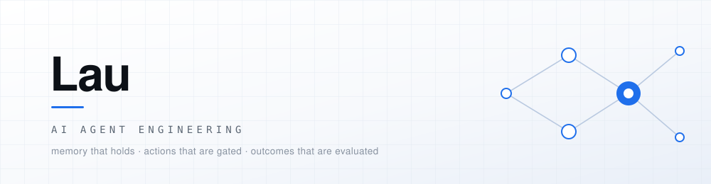

<picture>
  <source media="(prefers-color-scheme: dark)" srcset="./assets/banner-dark.svg">
  <source media="(prefers-color-scheme: light)" srcset="./assets/banner-light.svg">
  
</picture>

### AI Agent / LLM 应用工程师

做 Agent 系统，能跑通只是起点。我把更多时间花在三个问题上：**它记住的东西是不是真的**、**它动手之前谁说了算**、**它做完了凭什么说做对了**。

大部分 Agent 项目卡住，不是因为模型不够强，而是因为这三件事没有被工程化。下面四个项目分别从记忆、授权、评测、开源协作四个方向试着回答。

  
  
  
  
  
  
  

---

## 主力项目

### 跨境客户经营系统 · Agent 原生 CRM

面向跨境销售在 WhatsApp 上跟进客户的经营工作台。CRM 存业务事实，Agent 驱动跟进行动，Harness 管执行边界与授权。

**[cross-border-crm](https://github.com/lau0708/cross-border-crm)** · TypeScript · React · Supabase · Mem0 · Langfuse

三个真实会伤人的问题，和对应的做法：

- **记忆不可信。** 谁说过什么散落在会话里，Agent 分不清事实与猜测 → 人工确认的客户事实落本地 SQL 作唯一权威，Mem0 只对已确认条目排序、绝不做事实源；远端命中要过归属标识、运行标识、内容哈希三重核对，映射不回本地记录就丢弃。
- **自动跟进会闯祸。** 没有约束的自动发送能把「在谈」写成「已成交」 → 多个专家子代理只做只读证据生产者，以字段值哈希 + 来源版本产出断言；父流程是唯一写者，所有外发动作必须过独立授权闸门。
- **报告会撒谎。** 即使每条引用都指向真实记录，结论仍可能写错 → 两层评测：先核对成功工具观察里的来源标识与结构化字段，再跑独立语义 Judge，以更严格的一层合并结论，并区分「引用未观察」「字段矛盾」「语义待复核」三类问题。

负责人改跟进方向时，以 Mission 方向版本开新 Run，撤销旧待执行动作、作废旧草稿，并把接收确认与运行消息同事务落库 —— 新指令照样要再过一次授权。

### PulseOps · 脉巡 — 设备异常工单闭环 Agent

巡检发现异常 → LLM 诊断根因 → 幂等建单 → 飞书推卡片 → 群里点按钮处置 → 关单自动沉淀经验。

**[pulseops](https://github.com/lau0708/pulseops)** · Node 20 · React 19 · Python · 飞书卡片 × 回调 · GitHub Actions

- **终点不是「看见异常」，是「这张单被谁、在什么时候、用什么办法关掉」。** 大屏只解决了前半截，这里把后半截做成闭环留痕。
- **把不确定性关进一个格子。** 巡检和建单是确定性代码，只有诊断用 LLM 且可降级 —— 模型挂了不影响流程推进，只影响诊断质量。
- **幂等是硬约束，不是优化项。** 巡检每几分钟跑一次，重跑不能凭空多出十张单。
- 127 条回归用例 + CI 卡在 PR 上，改动先过测试再说。

---

## 其他项目

| 项目 | 是什么 | 栈 |
| --- | --- | --- |
| **[knowledge-agent-workbench](https://github.com/lau0708/knowledge-agent-workbench)** | 本地 RAG 知识库 + Agent 工作台。SQLite / ChromaDB 双存储索引、混合检索、**手写 Workflow 与 LangGraph 双实现对照**、HITL 审批、Trace 监控 | Python · FastAPI · bge-small-zh · DeepSeek · Vue 3 |
| **[oss-pr-skill](https://github.com/lau0708/oss-pr-skill)** | 一个 Claude Code skill，把「给开源做贡献」固化成证据驱动的流程。用它向 deer-flow 提了 3 个 PR，**全部已合并** | Shell |
| **[tripMind](https://github.com/lau0708/tripMind)** | LLM 协同高德 POI 的行程规划：JSON Mode 出结构化行程，再逐个景点校验真实坐标，SSE 流式返回进度 | Vue 3 · Node BFF · uni-app |

---

## 开源贡献

[bytedance/deer-flow](https://github.com/bytedance/deer-flow)（83k★，LangGraph Agent 框架）—— 3 个 PR，全部已合并：

| PR | 改动 | 合并耗时 |
| --- | --- | --- |
| [#5663](https://github.com/bytedance/deer-flow/pull/5663) | `fix(runtime)` 让原子线程操作共享同一个变更位置 | ~12h |
| [#5703](https://github.com/bytedance/deer-flow/pull/5703) | `fix(skills)` 用户级安装的内容扫描改从自身配置解析 | ~8h |
| [#5998](https://github.com/bytedance/deer-flow/pull/5998) | `fix(channels)` 为飞书 / 钉钉入站附件补上沙箱读权限位 | ~4h |

三个都是**自己挖的 bug**：没抢 issue，也没先问维护者。diff 都很小（含测试约 110–145 行），修的却是仓库自己文档里写明了、而某个实现悄悄违反的契约。

真正起作用的一条启发式：**测试不对称就是 bug 定位器。** 同一个接口有多个实现，其中只有一个为不变量写了回归测试 —— 没被测到的那个兄弟实现，就是 bug 所在。

---

## 技术栈

- **Agent 工程** — LangGraph · 手写 Workflow · Tool Registry / Dispatcher · HITL · Memory · Mem0 · Langfuse · RAG 与混合检索
- **后端** — TypeScript / Node · Python / FastAPI · Postgres / Supabase · SQLite · ChromaDB
- **前端** — React 19 · Vue 3 · Vite · Element Plus · uni-app
- **工程** — GitHub Actions · 回归用例 · 幂等设计 · Docker

---

## 联系

正在找 **AI Agent / LLM 应用工程师** 的机会。

邮箱：[lau0708@qq.com](mailto:lau0708@qq.com)
